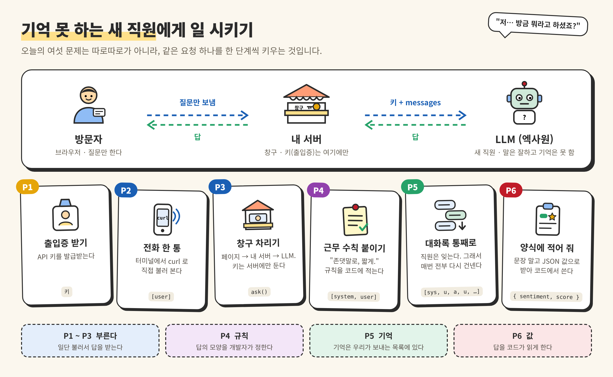

# 13주차 실습 — LLM API

LLM 을 채팅 창이 아니라 **HTTP API** 로 불러 봅니다. 키를 발급받고, curl 로 한 번 불러 보고, 입력창 하나짜리 페이지에서 질문을 보내 답을 받고, system 메시지로 답의 말투와 형식을 정하고, 앞의 말을 기억하는 대화를 만듭니다. 시간이 남으면 추가 문제(P6)에서 답을 문장이 아니라 JSON 값으로 받아 봅니다.

## 오늘 하는 일 한눈에

LLM 을 **말은 잘하지만 기억은 못 하는 새 직원**이라고 생각하면 됩니다. 오늘은 이 직원에게 일을 시키는 방법을 한 단계씩 늘려 갑니다. 여섯 문제는 따로따로가 아니라, **같은 요청 하나를 조금씩 키우는 것**입니다.

| 문제 | 직원에 비유하면 | 실제로 하는 것 | 요청에 새로 생기는 것 |
|---|---|---|---|
| **P1** | 출입증을 받는다 | API 키 발급 | 키 |
| **P2** | 전화로 한마디 걸어 본다 | 터미널에서 curl 로 직접 호출 | `messages: [user]` |
| **P3** | 창구를 차린다. 손님은 창구에 묻고, 출입증은 창구 안에만 둔다 | 페이지 → 내 서버 → LLM. 키는 서버에만 | (같은 요청을 코드로) |
| **P4** | 근무 수칙을 붙여 둔다. "존댓말로, 짧게" | 개발자가 코드에 규칙을 적는다 | `[system, user]` |
| **P5** | 직원은 방금 한 말도 잊는다. 그래서 매번 대화록 전체를 건넨다 | 지금까지의 대화를 통째로 다시 보낸다 | `[system, user, assistant, user, ...]` |
| **P6** | 말로 하지 말고 양식에 적어 달라고 한다 | 답을 문장이 아니라 JSON 값으로 받아 코드에서 쓴다 | `response_format` → `{ sentiment, score, summary }` |

- **P1 ~ P3**: 일단 불러서 답을 받는다.
- **P4**: 답의 **모양**을 개발자가 정한다.
- **P5**: 답에 **기억**을 붙인다. 기억은 모델이 아니라 우리가 보내는 목록에 있다.
- **P6**: 답을 사람이 아니라 **코드**가 읽게 한다.

팀 프로젝트에 LLM 기능을 붙일 때 쓰는 것이 이 네 가지(호출, 규칙, 기억, 값)입니다.

## 규칙

- **저장소**: 이 저장소를 템플릿으로 내 계정에 `oss-week13` 을 만들고 clone 합니다(정확히 이 이름, Public).
- 저장소 어디에도 **이름·학번을 적지 않습니다.**
- **API 키는 `.env` 에만 둡니다.** 코드, 커밋, 스크린샷에 넣지 않습니다.
- 명령은 전부 `oss-week13` 폴더에서 칩니다. 터미널은 **Git Bash**(Windows) 또는 macOS 터미널을 씁니다.

## 문제

| # | 내용 | 커밋 |
|---|---|---|
| [P1](problems/P1_key.md) | 엑사원 API 키 발급받기 | 없음 |
| [P2](problems/P2_curl.md) | 키를 `.env` 에 넣고 curl 로 한 번 불러 보기 | 없음 |
| [P3](problems/P3_ask.md) | 입력창 하나, 버튼 하나: 질문을 보내고 답 받기 | `p3: ask` |
| [P4](problems/P4_system.md) | system 메시지로 말투와 형식 정하기 | `p4: system` |
| [P5](problems/P5_chat.md) | 주고받는 대화: 메시지 목록을 통째로 보내기 | `p5: chat` |
| [P6](problems/P6_json.md) | (추가) 문장이 아니라 값으로 받기: JSON 답 | `p6: json` |

## 들어 있는 파일

코드를 쓸 곳에는 **`// TODO P3`** ~ **`// TODO P6`** 주석이 달려 있습니다. `llm.js` 에 네 군데, `public/chat.js` 에 두 군데입니다. VS Code 에서 `Ctrl+Shift+F` 로 `TODO` 를 검색하면 다 나옵니다.

| 파일 | 내용 | 고치는 문제 |
|---|---|---|
| `.env.example` | `.env` 의 틀. 키는 비어 있음 | — (P2 에서 복사) |
| `llm.js` | LLM 을 부르는 함수 `ask()`, `chat()`, `analyze()`. 비어 있음 | P3, P4, P5, P6 |
| `server.js` | 페이지를 내보내고 `POST /api/ask`, `/api/chat`, `/api/analyze` 를 받는 서버(Express) | — |
| `public/index.html`, `main.js` | 입력창과 버튼이 있는 페이지(P3, P4) | — |
| `public/chat.html`, `chat.js` | 대화 페이지 | P5 (`chat.js` 의 두 줄) |
| `public/analyze.html`, `analyze.js` | 후기 분석 페이지 | — |
