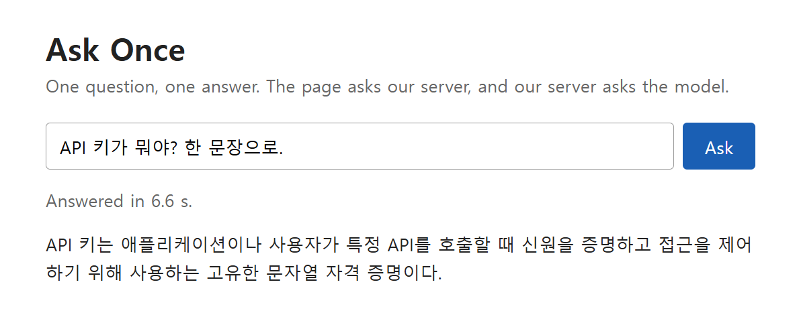
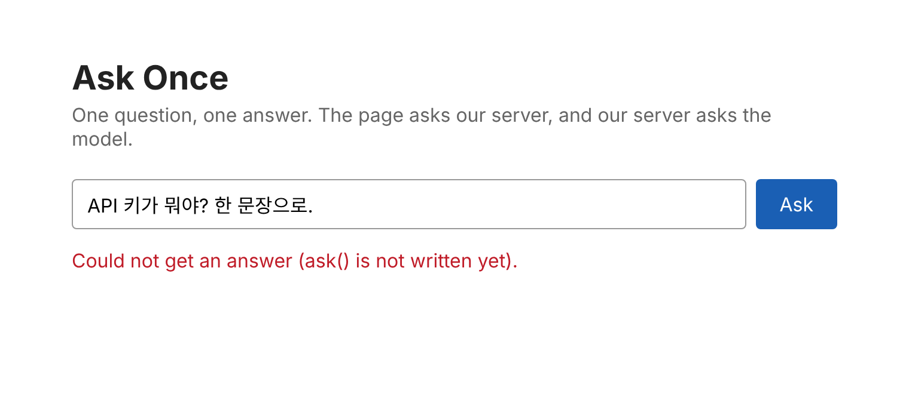

# P3. 입력창 하나, 버튼 하나: 질문을 보내고 답 받기

P2 에서는 터미널에서 curl 로 LLM 을 불렀습니다. 이번에는 **페이지에서 질문을 입력하고 Ask 를 누르면 답이 나오게** 합니다. 끝나면 아래 화면이 됩니다.



페이지가 LLM 을 직접 부르지는 않습니다. 그러려면 키를 브라우저로 보내야 하기 때문입니다. 페이지는 **내 서버**에 묻고, 키를 가진 내 서버가 LLM 에 묻습니다.

```
브라우저(public/main.js)  →  내 서버(server.js)  →  LLM(llm.js 가 부름)
        질문만 보냄              키를 붙여서 보냄
```

페이지(`public/`)와 서버(`server.js`)는 **이미 다 만들어져 있습니다.** 쓸 것은 `llm.js` 의 함수 `ask()` 하나입니다. P2 의 curl 명령을 `fetch` 로 옮기는 일입니다.

터미널은 두 개를 씁니다. 하나는 서버가 쓰고, 다른 하나에서 `curl`, `git` 을 칩니다. **둘 다 Git Bash** 로 엽니다(PowerShell 에서는 8번의 `curl` 이 깨집니다).

## 먼저 띄워 보기 (터미널 → 브라우저)

1. 필요한 패키지(Express)를 설치합니다.
   ```
   npm install
   ```
2. 서버를 켭니다. `Listening on http://localhost:3000` 이 나오면 켜진 것입니다. 이 터미널은 그대로 둡니다.
   ```
   npm start
   ```
   `npm start` 는 `node --env-file=.env server.js` 를 실행합니다. Node 가 `.env` 의 세 값을 읽어 `process.env` 에 넣어 줍니다. P2 의 `source .env` 와 하는 일은 같지만 서로 별개입니다.
3. 브라우저에서 `http://localhost:3000` 을 열고, `API 키가 뭐야? 한 문장으로.` 를 입력한 뒤 **Ask** 를 누릅니다.
4. **확인**: 빨간 글씨로 `Could not get an answer (ask() is not written yet).` 가 나오면 됩니다. 페이지와 서버는 이어져 있고, 서버가 아직 LLM 을 부를 줄 모르는 상태입니다.

   
5. 고치지는 않지만 두 곳을 읽어 봅니다.
   - `public/main.js` 의 `askServer()`: 페이지가 `/api/ask` 로 질문을 보내는 곳. 주소에 LLM 서비스도, 키도 없습니다.
   - `server.js` 의 `app.post("/api/ask", ...)`: 질문을 받아 `ask(question)` 을 부르고, 돌아온 문자열을 `{ "answer": ... }` 로 돌려주는 곳. `ask()` 가 `429`(서비스가 바쁨)로 실패하면 세 번까지 다시 부릅니다(`withRetry`).

## `ask()` 쓰기 (VS Code, `llm.js`)

6. `llm.js` 의 `ask()` 안, `// TODO P3` 표시가 있는 곳입니다. `throw new Error("ask() is not written yet");` 줄을 지우고, 아래 일을 하는 코드를 씁니다.

   | P2 의 curl | `ask()` 에서 |
   |---|---|
   | `"$LLM_BASE_URL/chat/completions"` | `fetch` 의 주소. `process.env.LLM_BASE_URL` 로 만듭니다 |
   | `-d` 가 있어서 POST | `method: "POST"` |
   | `-H "Authorization: Bearer $LLM_API_KEY"` | `headers` 의 `Authorization`. 값은 `Bearer `(뒤에 공백 하나) 다음에 `process.env.LLM_API_KEY` 를 붙인 문자열 |
   | `-H "Content-Type: application/json"` | `headers` 의 `"Content-Type"` |
   | `-d '{"model": ..., "messages": [...]}'` | `body`. 객체를 `JSON.stringify` 로 문자열로 만듭니다. `model` 은 `process.env.LLM_MODEL`, `messages` 의 `content` 는 인자 `question` |
   | 화면에 찍힌 JSON 에서 `content` 를 눈으로 찾음 | `await res.json()` 한 뒤 `choices[0].message.content` 를 꺼내 **`return`** |

   지킬 것은 세 가지입니다.
   - 응답이 실패(`res.ok` 가 `false`)이면 답을 꺼내지 말고 `` throw new Error(`LLM: HTTP ${res.status}`) `` 로 던집니다. 서버가 이 메시지를 페이지에 전합니다.
   - 답 앞에 `\n\n` 이 붙어 오므로 `.trim()` 으로 떼고 돌려줍니다.
   - `max_tokens` 는 넣지 않습니다. 이 모델은 생각하는 데 쓴 토큰도 거기에 포함해서, 작게 주면 답이 빈 문자열로 옵니다.

   참고: 13주차 녹강 Part 1(One Request)의 `fetch` 호출, 11주차 녹강의 `fetch` 로 POST 보내기.
7. 저장하고, 서버 터미널에서 `Ctrl+C` 로 끈 뒤 `npm start` 로 다시 켭니다. Node 는 켤 때 읽은 코드로 계속 돌아갑니다.

## 확인

8. **확인 (다른 터미널)**: 내 서버를 curl 로 불러 봅니다. 이번에는 키를 붙이지 않습니다.
   ```
   curl -sS http://localhost:3000/api/ask \
     -H "Content-Type: application/json" \
     -d '{"question": "What is an API key? One sentence."}'
   ```
   몇 초 뒤 `{"answer":"An API key is ..."}` 가 나오면 됩니다.
9. **확인 (브라우저)**: 페이지에 `API 키가 뭐야? 한 문장으로.` 를 입력하고 **Ask** 를 누릅니다. 몇 초 뒤 답이 나오고 그 위에 `Answered in 6.6 s.` 같은 줄이 나오면 됩니다(맨 위 그림). 답의 문장과 걸린 시간은 매번 다릅니다.
10. F12 → **Network** 탭을 열고 한 번 더 묻습니다. 목록의 `ask` 줄을 눌러 아래 두 가지를 봅니다.
    - **Headers** 의 Request URL 이 `http://localhost:3000/api/ask` 입니다. `api.exaone.ai` 가 아닙니다.
    - Request Headers 에 `Authorization` 이 없습니다. 키는 브라우저 어디에도 오지 않습니다.

## 커밋

11. 커밋하고 push 합니다. 커밋 메시지는 `p3: ask` 입니다.
    ```
    git add llm.js
    git commit -m "p3: ask"
    git push
    ```
12. **확인**: github.com 의 내 저장소 파일 목록에 `.env` 가 **없으면** 됩니다.

## 잘 안 될 때

| 화면에 나온 것 | 원인과 조치 |
|---|---|
| `node: .env: not found` | `.env` 가 없음 → P2 의 1, 2번 |
| `node: bad option: --env-file=.env` | Node 가 오래됨(20.6 이상 필요) → `node -v` 로 확인하고 https://nodejs.org 에서 LTS 를 새로 설치 |
| `LLM_API_KEY is not set. Check your .env file (P2).` | `.env` 에 키를 안 넣었거나 저장하지 않음 |
| `Error: listen EADDRINUSE: address already in use :::3000` | 서버가 이미 켜져 있음 → 다른 터미널의 서버를 `Ctrl+C` 로 끔 |
| 코드를 썼는데도 `ask() is not written yet` | 저장하지 않았거나 서버를 다시 켜지 않음 → 7번 |
| 서버 터미널에 `LLM is busy (429). Trying again... (1/3)` | 서비스가 바쁜 것. 내 코드 문제가 아님. `server.js` 가 1.5초 뒤 알아서 다시 부르니 기다리면 됨. 이 동작은 `ask()` 가 던진 메시지에 `429` 가 들어 있어야 함 |
| `Could not get an answer (LLM: HTTP 429).` | 네 번을 불러도 서비스가 바빴음 → 몇 초 뒤 **Ask** 를 다시 누름 |
| `Could not get an answer (LLM: HTTP 401).` | 키가 서비스에 제대로 안 감 → 헤더 이름이 `Authorization` 인지, 값 앞에 `Bearer ` 를 붙였는지 먼저 확인. 맞으면 `.env` 의 키를 고치고 서버를 다시 켬 |
| `LLM: HTTP 400` 또는 `LLM: HTTP 404` | 보낸 내용이나 주소가 틀림 → `body` 를 `JSON.stringify` 했는지, 주소 끝이 `/chat/completions` 인지, `model` 값을 확인 |
| `Cannot read properties of undefined (reading '0')` | 실패한 응답에서 답을 꺼내려 했거나(`res.ok` 를 먼저 확인), `res.json()` 앞에 `await` 가 빠짐 |
| curl 결과가 `{}` 이고, 페이지에는 답 없이 `Answered in ...` 만 나옴 | `ask()` 에 `return` 이 없음 |
| curl 결과가 `{"answer":""}` 이고, 페이지에는 답 없이 `Answered in ...` 만 나옴 | `max_tokens` 를 작게 넣음 → 지움 |

---

[← 문제 목록](../README.md#문제) · [이전: P2](P2_curl.md) · [다음: P4](P4_system.md)
