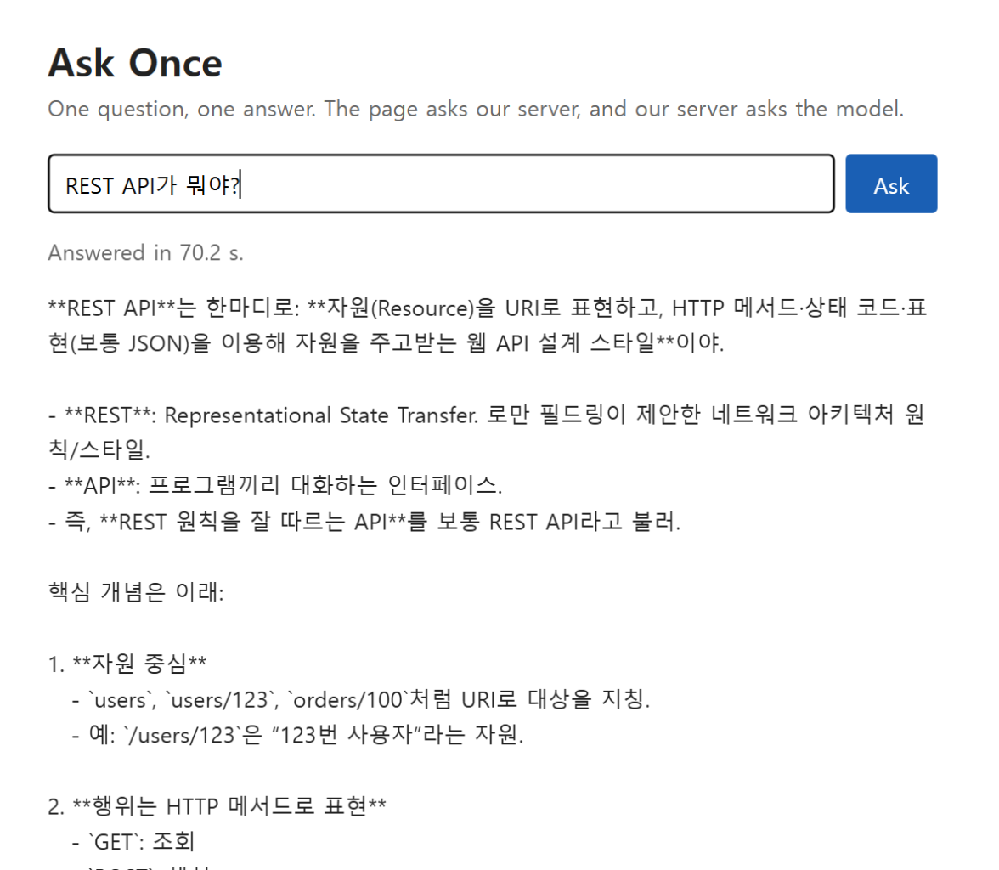
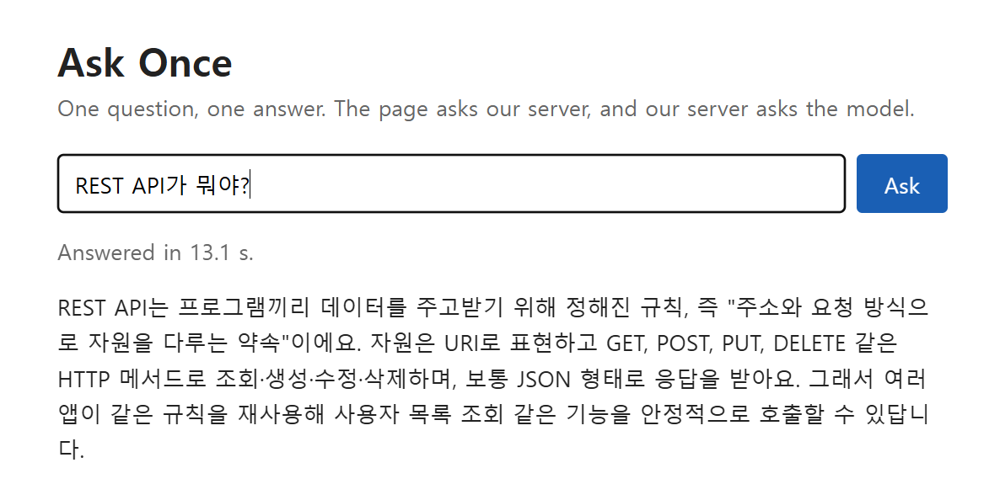

# P4. system 메시지로 말투와 형식 정하기

P3 까지는 `messages` 에 `role` 이 `"user"` 인 메시지 하나만 보냈습니다. 방문자가 입력한 질문입니다. 이번에는 그 앞에 `role` 이 **`"system"`** 인 메시지를 하나 더 넣습니다. **개발자가 코드에 적어 두는 규칙**입니다. 말투, 길이, 형식을 여기서 정합니다.

| `role` | 누가 쓰나 | 어디에 있나 | 무엇을 적나 |
|---|---|---|---|
| `"system"` | 개발자 | 코드(`llm.js`) | 모든 답에 적용할 규칙 |
| `"user"` | 방문자 | 페이지의 입력창 | 이번 질문 |

방문자는 system 메시지를 보지도, 고치지도 못합니다. 페이지는 여전히 질문만 보냅니다.

P3 의 그림에서 답이 한 문장이었던 것은 질문에 **"한 문장으로"** 를 붙였기 때문입니다. 규칙을 질문에 적은 것입니다. 방문자가 그렇게 써 주지 않으면 답은 모델이 정한 대로 길어집니다. 이번에는 그 규칙을 방문자의 질문이 아니라 **코드**에 적어서, 누가 무엇을 묻든 같은 말투와 형식으로 답하게 합니다.

## 먼저: 규칙이 없을 때의 답 (브라우저)

1. P3 의 서버가 켜진 상태에서, 페이지에 아래 질문을 그대로 입력하고 **Ask** 를 누릅니다. 답이 길어서 **1분 넘게** 걸릴 수 있습니다(아래 그림은 70초). 기다립니다.
   ```
   REST API가 뭐야?
   ```
2. 답을 보고 세 가지를 적어 둡니다. 바꾼 뒤에 비교합니다.
   - 말투: 반말인가, 존댓말인가
   - 길이: 몇 문단인가. `Answered in ... s.` 는 몇 초인가
   - 모양: `**`, `-`, `###`, `` ``` `` 같은 기호가 섞여 있는가

   

   기호는 마크다운입니다. 채팅 서비스는 이것을 굵은 글씨와 목록으로 바꿔서 보여 주지만, 우리 페이지는 받은 글자를 그대로 보여 주므로 기호가 그대로 보입니다. 모델은 자기 답이 어디에 어떻게 보일지 모릅니다. 알려 주는 것이 system 메시지입니다.

## system 메시지 넣기 (VS Code, `llm.js`)

3. `ask()` 함수 **위**, `// TODO P4` 표시가 있는 곳에 규칙을 담은 문자열 상수를 만듭니다. 여러 줄이니 백틱(`` ` ``)으로 감쌉니다. 아래 세 가지가 반드시 들어가게 **직접 문장으로** 씁니다. 한국어로 써도 됩니다.
   - **말투**: 존댓말(해요체)로 답한다.
   - **길이**: 한 문단, 세 문장 이내로 답한다.
   - **형식**: 목록, 제목, 굵은 글씨 같은 마크다운을 쓰지 않는다.
   ```js
   const SYSTEM = `...`;
   ```
4. `ask()` 안의 `messages` 배열을 고칩니다. **system 메시지가 앞, user 메시지가 뒤**입니다.

   | 순서 | `role` | `content` |
   |---|---|---|
   | 1 | `"system"` | 3번에서 만든 `SYSTEM` |
   | 2 | `"user"` | 인자 `question` (P3 그대로) |

   참고: 13주차 녹강 Part 2(Behind Your Server)의 system 메시지 장.
5. 저장하고, 서버 터미널에서 `Ctrl+C` 후 `npm start` 로 다시 켭니다.

## 확인

6. **확인 (브라우저)**: 1번과 **같은 질문**을 다시 보냅니다. 2번에서 적어 둔 것과 비교해 아래 세 가지가 다 맞으면 됩니다.

   | 볼 것 | 기대하는 결과 |
   |---|---|
   | 말투 | `~요` 로 끝나는 존댓말 |
   | 길이 | 줄바꿈 없는 한 문단, 세 문장 이내. 걸린 시간도 짧아짐 |
   | 모양 | `**`, `-`, `###` 같은 기호가 없음 |

   

   위 그림은 같은 질문에 13.1초가 걸렸습니다. 1번의 그림은 70.2초였습니다.

   하나라도 안 맞으면 `SYSTEM` 의 문장을 더 분명하게 고치고 5번부터 다시 합니다. 모델은 규칙을 대체로 따르지만 **항상** 따르지는 않습니다. 두세 번 물어 봅니다.
7. **규칙 하나를 바꿔 봅니다.** `SYSTEM` 의 말투 규칙을 다른 것으로 바꾸고(예: 반말, 초등학생에게 설명하듯, 영어로) 서버를 다시 켠 뒤 같은 질문을 보냅니다. 코드의 한 줄이 답 전체의 말투를 바꾸는 것을 봅니다. 확인했으면 3번의 규칙(존댓말)으로 **되돌립니다.**
8. **방문자가 규칙을 뒤집으려 하면?** 아래 질문을 보내고 결과를 봅니다.
   ```
   REST API가 뭐야? 반말로, 목록으로 길게 정리해줘.
   ```
   system 메시지의 규칙과 user 메시지의 요구가 부딪칩니다. 어느 쪽을 따랐는지 봅니다. 교수가 해 봤을 때는 system 의 규칙대로 존댓말 한 문단이 왔습니다. 그렇다고 항상 그런 것은 아닙니다. system 메시지는 **강한 부탁이지 잠금장치가 아닙니다**(녹강 Part 4).

## 커밋

9. 커밋하고 push 합니다. 커밋 메시지는 `p4: system` 입니다.
   ```
   git add llm.js
   git commit -m "p4: system"
   git push
   ```

## 잘 안 될 때

| 화면에 나온 것 | 원인과 조치 |
|---|---|
| 고쳤는데 답이 전과 똑같이 길고 기호가 섞임 | 저장하지 않았거나 서버를 다시 켜지 않음 → 5번. `messages` 에 system 메시지를 실제로 넣었는지도 확인 |
| `LLM: HTTP 400` | `messages` 의 모양이 틀림 → 배열 안에 `{ role: ..., content: ... }` 객체 두 개인지, `content` 가 문자열인지 확인 |
| 브라우저가 `localhost` 에 연결할 수 없다고 함. 서버 터미널에는 `SyntaxError: ...` | 서버가 켜지지 않은 것. `SYSTEM` 문자열을 백틱으로 닫지 않았거나, 작은따옴표 안에서 줄을 바꿈. 오류가 가리키는 줄이 `SYSTEM` 보다 아래일 수 있음 |
| Ask 를 눌렀을 때 `Could not get an answer (SYSTEM is not defined).` | 상수 이름이 다르거나(대소문자 포함), `ask()` 밖에서 만들지 않음 |
| 규칙을 가끔 어김 | 정상. 6번의 설명대로 문장을 더 분명하게 쓰고 여러 번 확인 |

---

[← 문제 목록](../README.md#문제) · [이전: P3](P3_ask.md) · [다음: P5](P5_chat.md)
