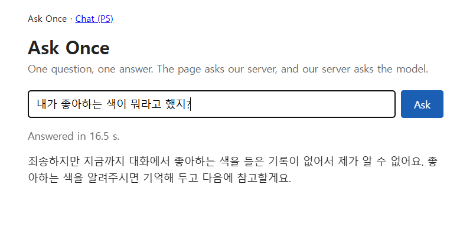
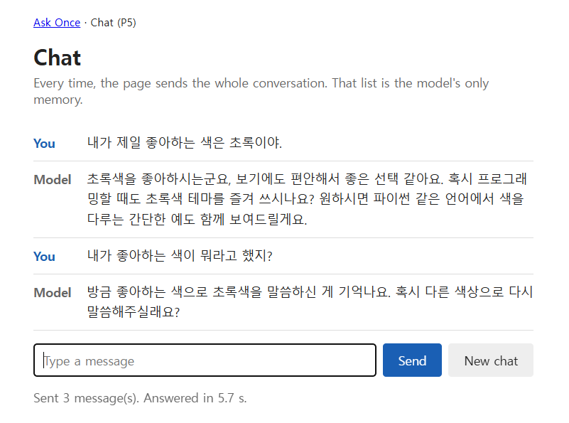

# P5. 주고받는 대화: 메시지 목록을 통째로 보내기

P4 까지는 질문 하나에 답 하나였습니다. 이번에는 **앞에서 한 말을 기억하는 대화**를 만듭니다.

먼저 알아야 할 것이 있습니다. **모델은 아무것도 기억하지 않습니다.** 요청 하나가 끝나면 그 내용은 모델에게 남지 않습니다. 채팅 서비스가 앞의 말을 기억하는 것처럼 보이는 이유는, 매번 **지금까지의 대화 전체**를 `messages` 에 담아 다시 보내기 때문입니다.

```
1번째 요청: [system, user1]
2번째 요청: [system, user1, assistant1, user2]
3번째 요청: [system, user1, assistant1, user2, assistant2, user3]
```

`role` 이 하나 더 나옵니다. **`"assistant"`** 는 모델이 앞에서 한 답입니다. 그 답도 우리가 목록에 넣어서 다시 보내 줘야 모델이 "내가 아까 이렇게 말했구나" 를 압니다.

| 누가 | 무엇을 맡나 | 파일 |
|---|---|---|
| 브라우저 | 대화 목록 `history` 를 갖고 있다가 매번 **전부** 보냄 | `public/chat.js` |
| 내 서버 | 받은 목록을 검사하고 `chat(history)` 를 부름 | `server.js` (고치지 않음) |
| `chat()` | 목록 **맨 앞에 system 메시지를 붙여** LLM 에 보냄 | `llm.js` |

쓸 것은 두 군데입니다. `llm.js` 의 함수 `chat()`, 그리고 `public/chat.js` 의 두 줄입니다.

## 먼저: 기억하지 못하는 것 확인 (브라우저)

1. 서버가 켜진 상태에서 P3 의 페이지(`http://localhost:3000`)에 아래 두 질문을 **차례로** 보냅니다.
   ```
   내가 제일 좋아하는 색은 초록이야.
   ```
   ```
   내가 좋아하는 색이 뭐라고 했지?
   ```
2. **확인**: 두 번째 답이 색을 모른다고 하면 됩니다. 두 요청은 서로 아무 관계가 없습니다. 두 번째 요청의 `messages` 에는 첫 번째 질문이 들어 있지 않기 때문입니다.

   

## `chat()` 쓰기 (VS Code, `llm.js`)

3. `llm.js` 맨 아래의 `chat(history)` 에서(`// TODO P5` 표시) `throw` 줄을 지우고 씁니다. `ask()` 와 **보내는 `messages` 만 다릅니다.**

   | | `ask(question)` | `chat(history)` |
   |---|---|---|
   | 받는 것 | 질문 문자열 하나 | `{ role, content }` 객체의 배열 |
   | `messages` | system 하나 + user 하나 | system 하나 + **`history` 의 모든 항목을 순서대로** |
   | 돌려주는 것 | 답 문자열 | 답 문자열 (같음) |

   - 배열을 다른 배열 안에 펼쳐 넣을 때는 전개 구문 `...history` 를 씁니다.
   - `fetch` 부분은 `ask()` 와 똑같습니다. `ask()` 의 코드를 복사해 `messages` 만 바꿔도 되고, 같은 부분을 함수 하나로 빼서 `ask()` 와 `chat()` 이 함께 써도 됩니다.
   - system 메시지는 **여기서** 붙입니다. 브라우저가 보낸 목록에 system 메시지가 섞여 있어도 `server.js` 가 버립니다. 규칙은 개발자의 것이기 때문입니다.

## 목록에 쌓기 (VS Code, `public/chat.js`)

4. `public/chat.js` 를 열어 전체를 한 번 읽습니다. 화면은 `render()` 가 **`history` 배열만 보고** 그립니다. 그런데 지금은 `history` 에 아무것도 넣지 않습니다. `// TODO` 주석 두 곳에 한 줄씩 씁니다.

   | 주석 | 쓸 것 |
   |---|---|
   | `// TODO P5 (1)` | 방문자의 메시지를 `history` 에 넣는다. `role` 은 `"user"`, `content` 는 `question` |
   | `// TODO P5 (2)` | 모델의 답을 `history` 에 넣는다. `role` 은 `"assistant"`, `content` 는 `answer` |

5. 저장하고, 서버 터미널에서 `Ctrl+C` 후 `npm start` 로 다시 켭니다. `public/` 안의 파일만 고쳤을 때는 브라우저에서 F5 면 되지만, 이번에는 `llm.js` 도 고쳤습니다.

## 확인

6. **확인 (브라우저)**: P3 의 페이지(`http://localhost:3000`) 맨 위에 있는 **Chat (P5)** 링크를 누릅니다. 주소가 `http://localhost:3000/chat.html` 로 바뀌고 Chat 페이지가 열립니다. 1번의 두 메시지를 차례로 보냅니다. 두 번째 답이 **색을 맞히면** 됩니다.

   

7. 입력창 아래의 상태 줄을 봅니다. 보낸 메시지 수가 한 번에 2씩 늘어납니다.

   | 몇 번째 | 상태 줄 | 보낸 것 |
   |---|---|---|
   | 1 | `Sent 1 message(s). ...` | user1 |
   | 2 | `Sent 3 message(s). ...` | user1, assistant1, user2 |
   | 3 | `Sent 5 message(s). ...` | user1, assistant1, user2, assistant2, user3 |

8. F12 → **Network** 탭을 열고 메시지를 하나 더 보냅니다. `chat` 줄 → **Payload**(요청 본문)에서 `messages` 배열을 펼쳐 봅니다. 지금까지의 대화가 전부 들어 있습니다. 대화가 길어질수록 **매 요청이 커지고**, 토큰도 그만큼 더 씁니다. 그래서 `server.js` 는 최근 20개만 받습니다.
9. **New chat** 을 누르고 `내가 좋아하는 색이 뭐라고 했지?` 를 보냅니다. 다시 모릅니다. 목록을 비웠기 때문입니다. 기억은 모델이 아니라 **`history` 배열**에 있었습니다.

## 커밋

10. 커밋하고 push 합니다. 커밋 메시지는 `p5: chat` 입니다.
    ```
    git add llm.js public/chat.js
    git commit -m "p5: chat"
    git push
    ```

## 잘 안 될 때

| 화면에 나온 것 | 원인과 조치 |
|---|---|
| `Could not get an answer (chat() is not written yet).` | `chat()` 을 안 썼거나, 저장하지 않았거나, 서버를 다시 켜지 않음 → 3번, 5번 |
| `Could not get an answer (messages is required).` | `history` 가 비어 있음 → `// TODO P5 (1)` 의 줄을 안 씀 |
| `Could not get an answer (the last message must be from the user).` 화면에 내용 없는 줄이 쌓이기도 함 | `// TODO P5 (1)` 에서 `{ role: "user", content: question }` 모양의 객체가 아니라 문자열을 넣었거나, `role` 이 정확히 `"user"`(소문자)가 아님 → 고치고 F5 |
| 내 메시지(You)만 쌓이고 모델의 답이 화면에 안 나옴. 상태 줄이 `Sent 1, 2, 3` 으로 1씩 늘어남 | `// TODO P5 (2)` 의 줄을 안 씀. 답이 `history` 에 없으니 화면에도, 다음 요청에도 없음 |
| 대화는 되는데 말투와 형식이 P4 와 다름(길고 기호가 섞임) | `chat()` 의 `messages` 맨 앞에 system 메시지를 안 넣음 |
| `LLM: HTTP 400` | `messages` 의 모양이 틀림 → `history` 를 펼치지 않고 배열째 넣었는지(`[system, history]`) 확인. `...history` 여야 함 |
| 고쳤는데 그대로 | `chat.js` 는 F5, `llm.js` 는 서버를 다시 켬. 그래도 그대로면 `Ctrl+Shift+R` 로 새로 고침 |
| 서버 터미널에 `LLM is busy (429). Trying again...` | P3 과 같음. 기다리면 됨 |

---

[← 문제 목록](../README.md#문제) · [이전: P4](P4_system.md) · [다음: P6](P6_json.md)
