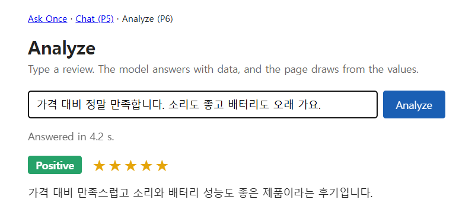
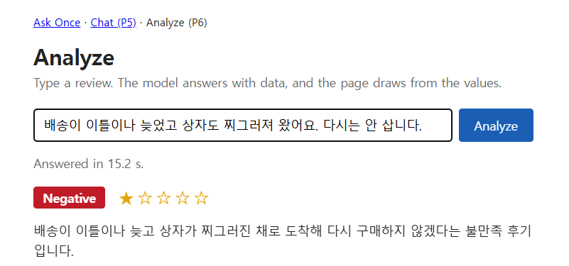

# P6. 문장이 아니라 값으로 받기: JSON 답

P5 까지 모델의 답은 **사람이 읽는 문장**이었습니다. 화면에 그대로 보여 주면 됐습니다. 그런데 답에 따라 **코드가 다르게 움직여야** 하면 문장으로는 곤란합니다.

예를 들어 후기를 넣으면 긍정은 초록, 부정은 빨강으로 칠하고 별점을 그리고 싶다고 합시다. 모델이 `"이 후기는 긍정적인 후기예요. 가격 대비 ..."` 라고 답하면, 코드는 이 문장에서 긍정인지 부정인지, 몇 점인지를 꺼낼 수 없습니다. 그래서 모델에게 **정해진 모양의 JSON** 으로 답하라고 하고, 그 값을 코드에서 씁니다.

```json
{ "sentiment": "positive", "score": 5, "summary": "가격 대비 만족스럽고 소리와 배터리 성능도 좋은 제품입니다." }
```

| 키 | 값 | 페이지에서 쓰는 곳 |
|---|---|---|
| `sentiment` | `"positive"`, `"negative"`, `"neutral"` 중 하나 | 라벨의 글자와 **색** |
| `score` | 1 ~ 5 의 정수 | **별의 개수** |
| `summary` | 한 문장 | 아래에 보여 주는 글 |

페이지(`public/analyze.html`, `analyze.js`)와 서버의 `POST /api/analyze` 는 이미 있습니다. 쓸 것은 `llm.js` 맨 아래의 함수 **`analyze(text)`** 하나입니다(`// TODO P6`).

## 먼저: 문장으로는 안 되는 것 확인 (브라우저)

1. P3 의 페이지(`http://localhost:3000`)에 아래를 보냅니다.
   ```
   이 후기는 긍정이야 부정이야? 가격 대비 정말 만족합니다. 소리도 좋고 배터리도 오래 가요.
   ```
2. 사람은 답을 읽고 긍정인 줄 압니다. 하지만 `if (answer === "positive")` 같은 코드는 쓸 수 없습니다. 답이 매번 다른 문장이기 때문입니다.

## `analyze()` 쓰기 (VS Code, `llm.js`)

3. `analyze(text)` 의 `throw` 줄을 지우고 씁니다. `ask()` 를 복사해서 시작하면 됩니다. 고칠 곳은 네 군데입니다.

   | # | 무엇을 | 어떻게 |
   |---|---|---|
   | (1) | system 메시지 | P4 의 `SYSTEM` 과 **다른 상수**를 하나 더 만듭니다(예: `SYSTEM_JSON`). "JSON 으로만 답한다, 키는 정확히 위의 세 개, 각 값의 종류와 범위" 를 문장으로 적습니다. 위 표의 내용을 그대로 옮기면 됩니다 |
   | (2) | 요청 본문 | `model`, `messages` 옆에 `response_format: { type: "json_object" }` 를 넣습니다. 서비스가 JSON 이 아닌 답을 내지 않게 해 줍니다 |
   | (3) | 답 꺼내기 | `content` 는 여전히 **문자열**입니다. `JSON.parse(...)` 로 객체로 바꾸고, 그 객체에서 세 값을 꺼냅니다(`const { sentiment, score, summary } = JSON.parse(...)`) |
   | (4) | **검사** | 객체의 세 값이 약속한 모양인지 확인하고, 아니면 `throw new Error("LLM: the answer has the wrong shape")`. 맞으면 `{ sentiment, score, summary }` 를 `return` |

   (4)의 검사는 세 가지입니다.
   - `sentiment` 가 `"positive"`, `"negative"`, `"neutral"` 중 하나인가 (`[...].includes(sentiment)`)
   - `score` 가 1 이상 5 이하의 정수인가 (`Number.isInteger(score) && score >= 1 && score <= 5`)
   - `summary` 가 문자열인가 (`typeof summary === "string"`)

   **모델의 답은 사용자 입력과 똑같이 믿지 않습니다.** JSON 으로 달라고 해도 키 이름을 바꾸거나, 점수를 `"5점"` 이라는 문자열로 주거나, 범위를 벗어난 값을 줄 수 있습니다. 검사 없이 그 값으로 그리면 별 칸이 비거나, 틀린 값이 아무 오류 없이 그려집니다. 참고: 13주차 녹강 Part 3(Don't Trust the Output).
4. 저장하고, 서버 터미널에서 `Ctrl+C` 후 `npm start` 로 다시 켭니다.

## 확인

5. **확인 (다른 터미널)**: 영어로 불러 봅니다. **같은 명령을 다섯 번쯤** 반복합니다(위쪽 화살표 키).
   ```
   curl -sS http://localhost:3000/api/analyze \
     -H "Content-Type: application/json" \
     -d '{"text": "Great sound and the battery lasts long. Worth the price."}'
   ```
   매번 `{"sentiment":"positive","score":5,"summary":"..."}` 처럼 **키 세 개짜리 객체**가 나오면 됩니다. P3 의 `{"answer":"..."}` 와 모양이 다릅니다. 가끔 `{"error":"LLM: the answer has the wrong shape"}` 가 섞이는 것은 정상입니다(검사가 일한 것). 한 번만 불러 보면 `response_format` 이나 검사를 빼먹은 코드도 통과해 버리니 여러 번 부릅니다.
6. **확인 (브라우저)**: P3 페이지 맨 위의 **Analyze (P6)** 링크를 누릅니다. 아래 두 후기를 차례로 넣고 **Analyze** 를 누릅니다.
   ```
   가격 대비 정말 만족합니다. 소리도 좋고 배터리도 오래 가요.
   ```
   ```
   배송이 이틀이나 늦었고 상자도 찌그러져 왔어요. 다시는 안 삽니다.
   ```
   첫 번째는 **초록 Positive** 와 별 4 ~ 5개, 두 번째는 **빨강 Negative** 와 별 1 ~ 2개가 나오면 됩니다. 색과 별은 모델이 준 **값**으로 코드가 그린 것입니다.

   

   

7. `public/analyze.js` 에서 `sentiment`, `score` 를 쓰는 네 줄을 찾아 읽습니다. 문장이었다면 쓸 수 없는 코드입니다.

## 커밋

8. 커밋하고 push 합니다. 커밋 메시지는 `p6: json` 입니다.
   ```
   git add llm.js
   git commit -m "p6: json"
   git push
   ```

## 잘 안 될 때

| 화면에 나온 것 | 원인과 조치 |
|---|---|
| `Could not analyze (analyze() is not written yet).` | 안 썼거나, 저장하지 않았거나, 서버를 다시 켜지 않음 |
| `Unexpected token ... is not valid JSON` (가끔만 나오기도 함) | 답이 JSON 이 아님 → (1) 의 system 메시지에 "JSON 으로만" 이 있는지, (2) 의 `response_format` 을 넣었는지 확인. `fetch` 의 옵션(`method` 옆)이 아니라 `body` 의 `JSON.stringify({...})` 안에 넣어야 함 |
| `analyze() returned nothing` | `analyze()` 에 `return` 이 없음 |
| `LLM: the answer has the wrong shape` 가 **매번** 나옴 | (3) 의 `JSON.parse` 를 안 하고 문자열에서 값을 꺼냄(가장 흔함). 그다음으로 (1) 의 system 메시지에 키 이름과 값의 범위가 정확히 적혀 있는지 확인 |
| `LLM: the answer has the wrong shape` 가 **가끔** 나옴 | 정상. 모델이 약속을 어긴 것을 검사가 잡은 것 → 다시 누름 |
| `LLM: HTTP 400` | `response_format` 의 모양이 틀림 → `{ type: "json_object" }` 인지, `messages` 와 같은 높이에 넣었는지 확인 |
| 오류 문구 없이 별 칸만 비어 있음 | `score` 가 숫자가 아닌데(예: `"5점"`) 검사를 통과함 → (4) 의 `Number.isInteger` 검사를 확인 |
| `Invalid count value` | `score` 가 1 ~ 5 밖의 숫자인데 검사를 통과함 → (4) 의 범위 검사를 확인 |
| `analyze() must return an object` | `JSON.parse` 를 안 했거나, 객체가 아니라 문자열을 `return` 함 |
| 라벨만 `?` 로 나옴(별과 요약은 정상) | `sentiment` 가 세 값이 아닌데 검사를 통과함 → (4) 의 `includes` 검사를 확인 |

---

[← 문제 목록](../README.md#문제) · [이전: P5](P5_chat.md)
